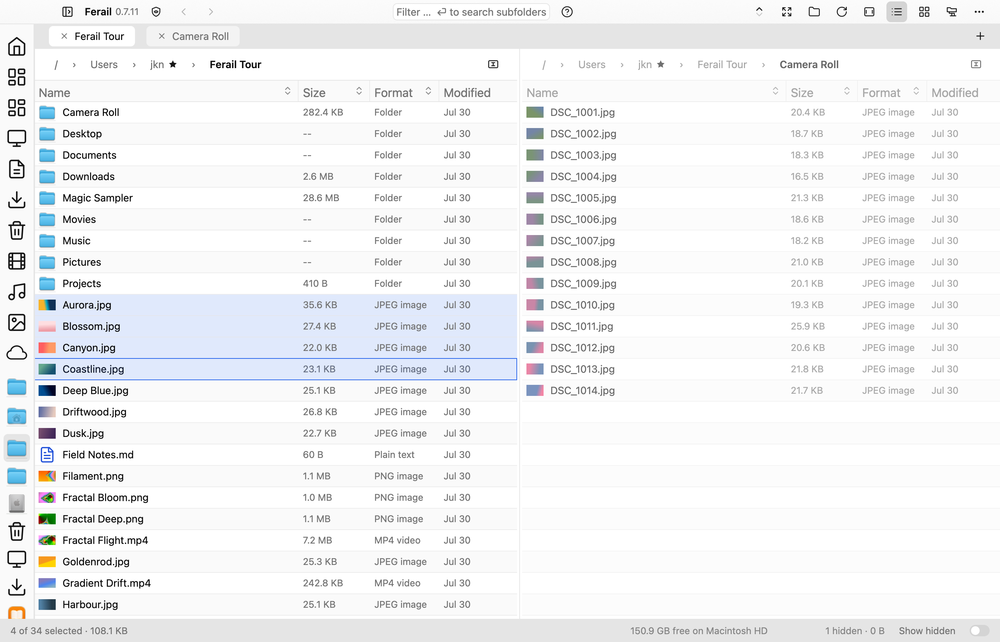

# Split View

← [Feature notes](README.md) · [Status](../STATUS.md) ·
[Architecture](../ARCHITECTURE.md) · [Open work](../../TODO.md)

Split view shows two of a window's tabs at once, side by side or stacked, so
files can be compared and moved between two folders, two disks or two trees
without losing sight of either.

## What the user gets

| Command | Shortcut | Effect |
| --- | --- | --- |
| Split Right | Cmd+\ | Show two tabs side by side. On a side-by-side split, close it. |
| Split Down | Cmd+Shift+\ | Show two tabs stacked. On a stacked split, close it. |
| Switch Pane | Cmd+Option+\, Option+Tab on macOS | Move the focus to the other pane. |

The three commands are in the View menu. A split along the other axis turns
instead of closing.

- **Which tabs.** A split lines up the active tab with its right-hand
  neighbour in the tab strip, or its left-hand one when it is the last. A
  window with a single tab duplicates it.
- **One tab strip.** Both visible tabs are marked in the strip. Picking any
  other tab shows it in the focused pane; the other pane stays put.
- **Focus.** Clicking, right-clicking or dropping in a pane focuses it, and
  the click acts in the same gesture. The pane without the focus is dimmed.
- **What follows the focus.** The title bar (Back, Forward, filter, view
  mode), the sidebar, the preview pane and the status bar all describe the
  focused pane.
- **Per pane.** Folder, history, selection, sort, list or grid view and
  scroll position, because each pane is a tab.
- **Moving files.** Drag from one pane to the other. The pane under the
  pointer takes the focus, and the drop lands in its folder or in the folder
  row under the pointer, with the copy or move rules of any other drop.
- **Divider.** Drag it to resize; double-click it to even the panes out.
- **Closing.** Closing either visible tab closes the split and leaves the
  other tab active.

A split lasts as long as its window. It is not restored at launch, as tabs
are not.

## The model

A pane is a slot that shows a tab the window already owns. It is not a second
kind of listing.

`Shell::split` holds a `PaneSplit`: the `TabId` in each of the two slots, the
axis, the divider ratio, and the slot that last had the focus.
`Shell::active` keeps its single meaning, the tab commands act on, which in a
split window is the focused pane's tab. Every handler that resolves against
the active tab therefore works in either pane without knowing about panes.

Two mechanisms carry the whole feature:

1. **Reconciliation, not bookkeeping.** `Shell::sync_split` matches the split
   against the tab list and the active tab at the top of every render and
   before any command that reads it. New Tab, Close Tab, Reopen Closed Tab,
   tab reordering and tab selection change `tabs` and `active` as they always
   did; none of them mentions the split. The rules are the pure
   `PaneSplit::reconcile`:
   - a pane whose tab is gone collapses the split onto the surviving tab;
   - an active tab shown in a pane moves the focus to that pane;
   - an active tab shown in neither pane replaces the focused pane's tab.
2. **Focus before dispatch.** Each pane element focuses its tab in the
   capture phase of a mouse press, of a release that ends a drag, and on drag
   hover. Row and cell handlers run in the bubble phase, after `active`
   already names their pane.

## Rendering

`Shell::split_body` builds the area below the tab strip. For each slot it
makes that slot's tab the active one, builds `Shell::pane_column` (breadcrumb,
Trash bar, listing with its drop target), and restores the focused tab. The
pane elements sit under distinct element ids, so nothing inside a pane needs
an id of its own per slot.

Whatever outlives that build step must not read `active_tab()` to find its
tab:

- the icon grid's row closure and its viewport warm look the tab up by
  `TabId`;
- `warm_loaded_viewport_in_tab` and the grid warm accept any tab that is on
  screen (`Shell::tab_is_shown`), so a reload of the unfocused pane still
  warms its icons and thumbnails;
- a table's event subscription drops events from a tab that is not active,
  which focus-before-dispatch makes unreachable for pointer input.

The first pane takes `ratio` of the split area and the second absorbs the
rest, so a window resize keeps the proportion. The divider drag is tracked at
the window root, like the icon-size scrub.

## Prime Directive

Split view adds no I/O. Both tabs already enumerate, watch and warm through
their own generation counters and cancel flags; a split only puts a second
one on screen.

## Out of scope

- **More than two panes.** Sorting between two places is the use case; three
  and four panes add layout modes without adding a new capability.
- **Synchronized browsing**, where navigating one pane drives the other.
- **A tab strip per pane.** One strip keeps tabs a window-level concept.
